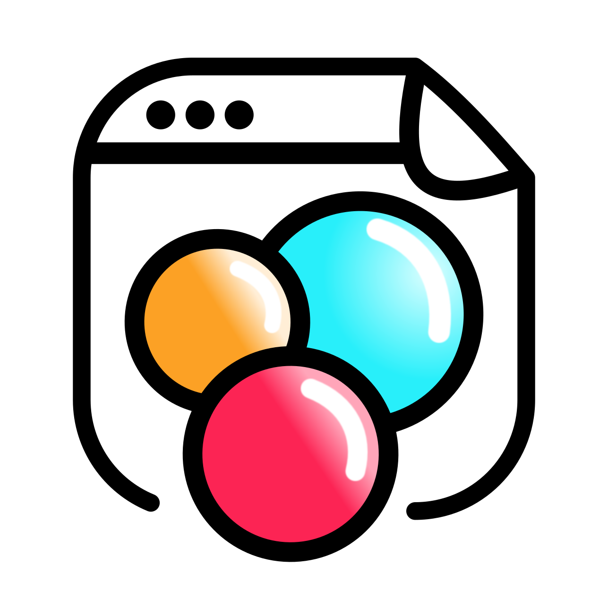
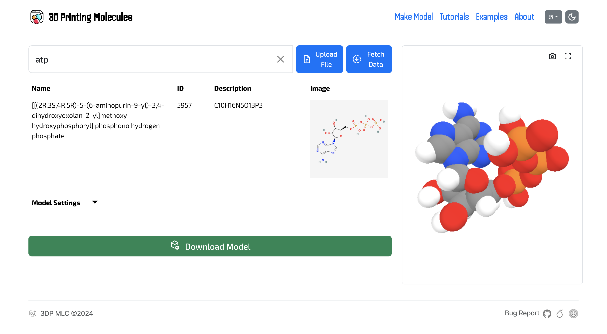
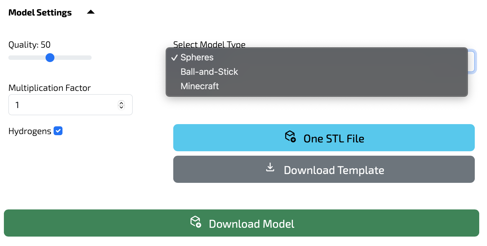

<div align="center">



# 3D Printing Molecules

**Free, browser-based tool that turns molecules from PubChem, PDB, COD or your own files into multicolor, print-ready 3MF and STL models in seconds.**

[](https://3dmolekuly.vscht.cz)

[](LICENSE)


[**Open the app**](https://3dmolekuly.vscht.cz) ·
[Tutorial](https://3dmolekuly.vscht.cz/en/tutorials) ·
[About](https://3dmolekuly.vscht.cz/en/about) ·
[Report a bug](https://github.com/3D-Molekuly/3D-Print-Molecules/issues)



</div>

---

## Why?

Physical molecular models make shape, symmetry and intermolecular interactions tangible in a way a screen cannot — but building them from kits is slow, and turning structural data into a clean, multicolor print usually means hours in PyMOL, Blender and a slicer.

**3D Printing Molecules** does the whole pipeline in the browser: find a structure, pick a representation, and download a watertight model whose atoms are already split by element and colored with CPK colors. Open it in your slicer and print. No installation, no account — model generation runs entirely in your browser.

It is built for **teachers, students, researchers, science communicators and makers**, and is developed at the **University of Chemistry and Technology, Prague** and the **First Faculty of Medicine, Charles University**.

## Features

### 🔎 Get a structure from anywhere

| Source | What you can load | Example input |
| --- | --- | --- |
| **PubChem** | Small organic & bioorganic molecules by name, CID or CAS number (with autocomplete) | `caffeine`, `2244`, `50-78-2` |
| **RCSB PDB** | Full protein / nucleic-acid structures, optional single-chain filter and crystal water | `1CRN`, `4HHB`, `insulin` |
| **PDB Chemical Component Dictionary** | Ligands, cofactors, drugs and metal complexes | `HEM`, `ATP`, `CLA` |
| **Crystallography Open Database (COD)** | Inorganic crystals and minerals, searchable by formula or name | `NaCl`, `CaCO3`, `quartz` |
| **SMILES / InChI / IUPAC → 3D** | Any structure, 3D coordinates generated via NIH CACTUS | `CC(=O)Oc1ccccc1C(=O)O` |
| **Draw it yourself** | Built-in 2D structure editor, converted to a 3D model | — |
| **Your own file** | Drag & drop `.sdf`, `.pdb` or `.cif` | — |

### 🧪 Six printable representations

| Style | Description |
| --- | --- |
| **Spheres (space-filling / CPK)** | Classic van der Waals model, one part per element |
| **Spheres – split for gluing** *(beta)* | Each atom becomes its own watertight solid with flat or cup-shaped cut faces and optional filament peg holes — multicolor models on a **single-extruder** printer |
| **Ball-and-stick** | Adjustable atom size, bond diameter, multiple bonds and bond grouping |
| **Ball-and-stick – moving joints** *(beta)* | **Print-in-place rotating joints** on single bonds, with FDM and SLA presets, so you can demonstrate conformations by hand |
| **Sticks** | Clean licorice-style model |
| **Minecraft** | Voxel model, just for fun |

### 🖨️ Ready for your slicer

- **3MF export** with multi-part objects and pre-assigned CPK colors — opens colored in PrusaSlicer, Bambu Studio and OrcaSlicer
- **ZIP of separate STLs** (one per element) as a universal fallback, or a single merged STL
- **One-click "Open in slicer"** for PrusaSlicer, Bambu Studio, OrcaSlicer and Ultimaker Cura
- Live **print dimensions** with a reference 250 × 210 mm build plate, adjustable scale (mm per Å), quality and hydrogen toggle
- **PrusaSlicer 3.0 plugin**: a simplified offline version that builds the model right in the slicer, with filaments matched to CPK colors — see [molekuly3d/3d-molekuly-prusaslicer-plugin](https://github.com/molekuly3d/3d-molekuly-prusaslicer-plugin)

### ✨ And more

- **Shareable links** that restore the molecule and all model settings, e.g.
  [`?source=pubchem&mol=caffeine&style=ball-and-stick`](https://3dmolekuly.vscht.cz/?source=pubchem&mol=caffeine&style=ball-and-stick)
- Transparent **PNG snapshots**, fullscreen and auto-rotating preview, light / dark background
- **Installable PWA** with offline caching
- Fully bilingual UI: **English** and **Czech**
- Geometry is generated **client-side** — your uploaded structure files are processed in the browser

## Quick start (using the app)

1. Open **[3dmolekuly.vscht.cz](https://3dmolekuly.vscht.cz)**.
2. Search for a molecule (e.g. *caffeine*), use **Advanced search** for PDB / COD / SMILES / drawing, or drop in a file.
3. Choose a model style and tune it in **Model Settings**.

   

4. Click **Download 3MF (Color Model)** — or **Open in slicer**.
5. In the slicer, assign filaments to the pre-colored parts, set scale, supports and layer height, and print. If you used the STL ZIP, confirm *"Multi-part object detected"* with **Yes**.

A detailed, illustrated walkthrough is in the [tutorial](https://3dmolekuly.vscht.cz/en/tutorials).

### Printing tips

- Large biomolecules print best as space-filling models at reduced quality; consider printing only a chain or a ligand.
- Ball-and-stick models need supports under overhanging atoms — tree / organic supports work well.
- For print-in-place joints, **do not** put supports inside the joints and **do not** merge shells in the slicer.
- No multi-material printer? Use **Spheres – split for gluing** and print each color separately.

## Development

**Requirements:** Node.js ≥ 20 and npm.

```bash
git clone https://github.com/3D-Molekuly/3D-Print-Molecules.git
cd 3D-Print-Molecules
npm install
npm run dev -- --open
```

| Command | Description |
| --- | --- |
| `npm run dev` | Start the dev server with hot reload |
| `npm run build` | Production build (Vercel adapter) |
| `npm run preview` | Serve the production build locally |
| `npm run check` | Type-check Svelte and TypeScript |
| `npm test` | Run the Vitest suite |

### Tech stack

- **[SvelteKit](https://kit.svelte.dev/)** + **TypeScript**, **Bootstrap 5**, **svelte-i18n**
- **[Three.js](https://threejs.org/)** for geometry generation and the 3D preview
- **[Manifold](https://github.com/elalish/manifold)** (WebAssembly) for robust CSG / watertight meshes, run in a Web Worker
- **[Kekule.js](https://partridgejiang.github.io/Kekule.js/)** for the 2D structure editor
- **JSZip** for 3MF / ZIP packaging
- Data: **PubChem PUG REST**, **RCSB PDB** (Search & Data APIs), **COD**, **NIH CACTUS**

### Project structure

```
src/
├── routes/            # Pages (/, /en|cs/tutorials, /en|cs/about) and API endpoints
├── lib/
│   ├── molecules/     # Data fetching (PubChem, PDB, COD, CACTUS) and file parsers
│   ├── geometry/      # Glued spheres, print-in-place joints (CSG via Manifold)
│   ├── threejsFc/     # Scene, mesh generation and 3MF/STL export
│   ├── components/    # UI components (advanced search, drawing panel, …)
│   ├── functions/     # Shareable URLs, networking, helpers
│   └── translations/  # en.json, cs.json
static/                # PWA manifest, icons, periodic table & covalent radii data
```

## Contributing

Contributions, bug reports and ideas are very welcome — whether you are a chemist, educator, developer or maker.

1. Check the [open issues](https://github.com/3D-Molekuly/3D-Print-Molecules/issues) or open a new one to discuss your idea.
2. Fork the repository and create a branch: `git checkout -b feature/my-feature`.
3. Run `npm run check` and `npm test` before committing.
4. Open a pull request with a short description and, ideally, a screenshot or printed result.

New UI strings must be added to both `src/lib/translations/en.json` and `cs.json`.

Printed something nice? Share a photo in [Issues](https://github.com/3D-Molekuly/3D-Print-Molecules/issues) — we love seeing the models in classrooms.

## History

The project started in 2023 as a PyMOL script, evolved through several Python iterations and grew into this web application. It received an award at the **25th Student Scientific Conference (SVK)** of the First Faculty of Medicine, Charles University.

## Team & acknowledgments

Developed as a collaboration of:

- **Department of Chemistry Education and Humanities, University of Chemistry and Technology, Prague (UCT Prague)**
- **First Faculty of Medicine, Charles University**

Thanks to the teams behind PubChem, RCSB PDB, the Crystallography Open Database, NIH CACTUS, SvelteKit, Three.js, Manifold and Kekule.js.

## Citing

If you use the tool in teaching materials or a publication, please cite it as:

> *3D Printing Molecules* — web application for multicolor 3D printing of molecular structures. UCT Prague & First Faculty of Medicine, Charles University. https://3dmolekuly.vscht.cz

## License

Released under the [GNU General Public License v3.0](LICENSE).

---

<sub>Keywords: 3D print molecules · molecular 3D printing · PubChem to STL · PDB to 3MF · CIF to STL · multicolor molecule model · chemistry education · ball-and-stick model · space-filling CPK model</sub>
